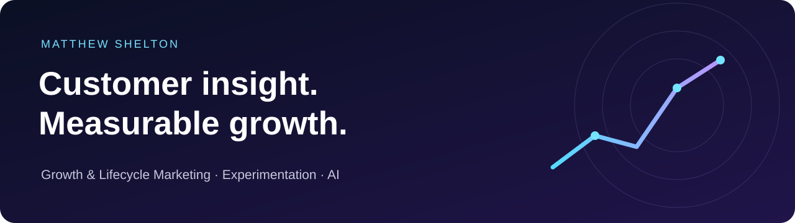

# Matthew Shelton
### Growth & Lifecycle Marketer

I’ve spent 6+ years in growth and lifecycle marketing across consumer brands, including footwear, apparel and ecommerce. My experience includes Heelys growth initiatives and international relaunch work for DVS and Simple Shoes.

The projects below bring that background into customer acquisition, product onboarding and lifecycle messaging.

[LinkedIn](https://www.linkedin.com/in/mattshelton2000/) · [Quick portfolio overview](START-HERE.md)

## Selected work

### Pango · Finding a useful reason to start a sales conversation

A footwear and apparel acquisition proposal with ten researched brands, outreach copy and a prospect tracker. The research focuses on specific shipping and returns workflows rather than assuming a brand needs another tool.

**[Case study and campaign assets](case-studies/pango.md)** · [Landing page and email designs](https://www.figma.com/design/BxZFyUx1DTxEwEXugZwpEe?node-id=2-2)

### Illume · What happens after the first useful insight?

I connected my wearable, received an automatic insight and asked Taro for a chart. That walkthrough became an activation proposal covering sender recognition, the first reply and chart-request status.

**[Walkthrough and recommendations](case-studies/illume.md)** · [Email and landing-page designs](https://www.figma.com/design/Rhk6OdhcG6vIbMKSTIRBio?node-id=4-136)

### Ray · Helping someone start, then come back

A growth and lifecycle proposal centered on two moments: completing a first workout and returning after a disrupted routine. Includes welcome and return email designs plus a proposed first-week journey.

**[Strategy and email mockups](case-studies/ray.md)** · [Figma layouts](https://www.figma.com/design/e99rFNf5MD8VNKjVROExqw/?node-id=0-1)

These are independent projects, not deployed client campaigns. Each case study explains the work completed and how AI contributed.

## Commercial experience

| Work | Contribution |
| :--- | :--- |
| **Heelys / BBC International** | Integrated growth initiatives contributing to **100%+ sales growth** and **75%+ sell-through improvement** |
| **DVS** | International relaunch across **12 distributor markets and three product seasons**, contributing to **150%+ brand-awareness growth** |
| **Simple Shoes** | Work on the brand’s international relaunch |
| **Freelance / independent projects** | Customer research, acquisition proposals, lifecycle messaging and campaign assets |

The figures describe separate professional initiatives, not results from the projects above. [Read more about my experience](case-studies/consumer-growth.md).

## Workflow experiments

Alongside the marketing projects, I’ve used AI assistance to build two small demonstrations:

- **[Customer Voice → Campaign Brief](https://github.com/matthewshelton257/customer-voice-to-campaign):** turns sample reviews into a messaging brief with references to the input.
- **[AI Lifecycle Studio](ai-lifecycle-studio/README.md):** lets a reviewer inspect sample emails, introduce errors and check them before export.

Both run with predefined rules and sample data by default. They demonstrate workflow design, not production AI performance.

Courses and certifications

| Certification | Issuer | Completed |
| :--- | :--- | :--- |
| Growth Marketing Foundations | LinkedIn | October 2025 |
| Using Generative AI across the Marketing Lifecycle | LinkedIn | February 2026 |
| Generative AI for Digital Marketers | LinkedIn | February 2026 |
| SEO Foundations | LinkedIn | February 2026 |
| Claude Code in Action | Anthropic | March 2026 |
| Claude Marketing | Claude Marketers | September 2026 |

Explore my background and credentials on [LinkedIn](https://www.linkedin.com/in/mattshelton2000/).

[Get in touch on LinkedIn](https://www.linkedin.com/in/mattshelton2000/).
