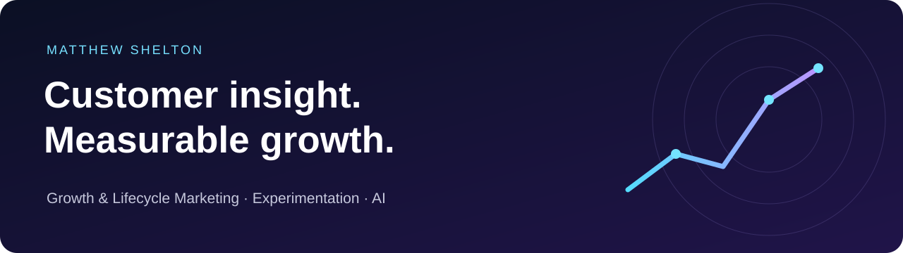

# Matthew Shelton
### Growth & Lifecycle Marketer

I connect customer insight with acquisition, activation, conversion and retention. My 6+ years in consumer growth span integrated campaigns, international go-to-market work and cross-functional execution. My independent projects apply that experience to lifecycle strategy, experimentation and AI-assisted marketing tools.

**[Start here: selected work for growth marketing](START-HERE.md)** · [LinkedIn](https://www.linkedin.com/in/mattshelton2000/)

## Commercial experience

| Work | Reported contribution |
| :--- | :--- |
| **Heelys / BBC International** | Integrated growth initiatives contributing to **100%+ sales growth** and **75%+ sell-through improvement** |
| **DVS international relaunch** | **12 distributor markets**, **three product seasons** and work contributing to **150%+ brand-awareness growth** |
| **Andrews University** | **10,000+ social interactions** in the first month of targeted campaign work |

These are separate reported outcomes from professional work, not isolated experiment results or claims of sole attribution. [Read the experience summaries](case-studies/consumer-growth.md).

## Selected projects

### 01 · Pango: a focused B2B acquisition pilot
**Account research · Outbound campaign development · Pipeline planning**

A complete acquisition package for footwear and apparel brands: ten researched accounts, a three-touch sequence, three tailored email examples, a working Notion prospect tracker and a four-week measurement plan.

Independent proposal developed with AI assistance. Research and assets are complete; no prospect campaign or measured results are claimed.

**[View the Figma designs](https://www.figma.com/design/BxZFyUx1DTxEwEXugZwpEe?node-id=2-2)** · [Read the case study and created assets](case-studies/pango.md)

### 02 · Illume: from first insight to first conversation
**Product walkthrough · Activation · Lifecycle and interface copy**

A hands-on walkthrough translated into a first-reply activation proposal. Includes an evidence log, onboarding copy, Signals empty-state guidance, chart-status messages and a defined experiment.

Independent research and AI-assisted proposal. Observations come from one account; changes have not been deployed and no lift is claimed.

**[View the Figma designs](https://www.figma.com/design/Rhk6OdhcG6vIbMKSTIRBio?node-id=4-136)** · [Explore the walkthrough, copy and experiment](case-studies/illume.md)

### 03 · Ray: from first workout to repeat behavior
**Growth strategy · First-week lifecycle · Figma email concepts**

A proposed 90-day plan connecting acquisition with activation, repeat use and return journeys. Includes desktop and mobile Figma concepts, behavioral triggers, suppression rules and experiments focused on completed actions.

Independent strategy, not commissioned by or affiliated with Ray. No deployment or measured results claimed.

**[View the strategy and email mockups](case-studies/ray.md)**

## Working tools

**[Customer Voice → Campaign Brief](https://github.com/matthewshelton257/customer-voice-to-campaign)** turns synthetic reviews into evidence-linked messaging. Built with AI assistance; the default uses rules and templates. Optional local-model inference remains unverified. [Read the sample output](https://github.com/matthewshelton257/customer-voice-to-campaign/blob/main/examples/brief.md).

**[AI Lifecycle Studio](ai-lifecycle-studio/README.md)** demonstrates campaign validation, deliberate failure cases, human review and local exports. Working sample mode with no live AI calls.

## How I approach growth

Start with the customer problem. Define the behavior that would demonstrate value. Connect acquisition and lifecycle messaging to that behavior, then measure the outcome.

I’m interested in work that combines customer research, practical automation and clear decisions about what to test next. My portfolio distinguishes professional outcomes from independent proposals and working demonstrations.

Additional writing, learning and experiments

[Product and lifecycle copy](copywriting/README.md) includes Ray concepts plus clearly labeled AI-generated exercises for fictional products.

[AI evaluation plan](ai-evaluation/README.md) contains a test prompt, rubric and evidence-capture templates. It is prepared for future testing; no model-comparison results are claimed.

## Relevant learning

| Certification | Issuer | Completed |
| :--- | :--- | :--- |
| Growth Marketing Foundations | LinkedIn | October 2025 |
| Using Generative AI across the Marketing Lifecycle | LinkedIn | February 2026 |
| Generative AI for Digital Marketers | LinkedIn | February 2026 |
| SEO Foundations | LinkedIn | February 2026 |
| Claude Code in Action | Anthropic | March 2026 |
| Claude Marketing | Claude Marketers | September 2026 |

Explore my background and credentials on [LinkedIn](https://www.linkedin.com/in/mattshelton2000/).

**Let’s talk about growth, lifecycle marketing and practical AI workflows.** [Connect on LinkedIn](https://www.linkedin.com/in/mattshelton2000/).
