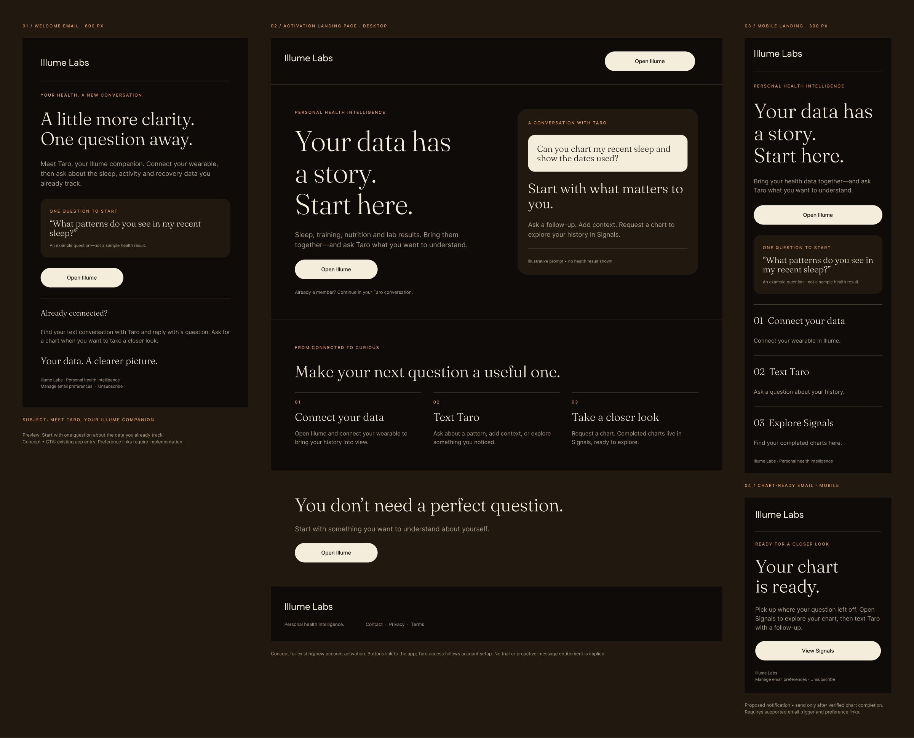

# Illume Labs
## From first insight to first conversation

**Product walkthrough · Activation · Lifecycle messaging · UX copy · Experiment design**

A hands-on product exploration and prepared activation project focused on the moment after a new wearable-connected user receives a useful insight: recognizing the sender, asking a question and understanding what happens next.

**Status:** Independent research and four-week project proposal. Not commissioned or implemented by Illume. One account walkthrough informed the work; no activation or retention improvement is claimed.

**Contribution:** Matthew used the product, connected wearable history, inspected the experience and tested a conversational chart request. The research synthesis, message drafts and Notion proposal were developed with AI assistance.

## Figma email and landing-page designs

**[Open the editable Illume designs in Figma](https://www.figma.com/design/Rhk6OdhcG6vIbMKSTIRBio?node-id=4-136)**

| Design created | Purpose |
| :--- | :--- |
| Welcome email | Introduce Taro and give a new user a concrete first question |
| Desktop activation landing page | Explain the path from connected data to a useful conversation and deeper exploration |
| Mobile activation landing page | Adapt the same journey for a narrow screen |
| Chart-ready email | Show a proposed return path to Signals after verified chart completion |

The visual direction uses warm black, cream and amber with Fraunces headlines and conversational copy. The layouts extend the earlier walkthrough and written recommendations into editable visual concepts developed with AI assistance.

The chart-ready email is a proposed notification, not evidence that the unresolved chart request completed. Sending it would require a verified completion event and supported email behavior. These concepts have not been deployed.

## Open the created assets

| Created artifact | What it contains |
| :--- | :--- |
| [Figma design set](https://www.figma.com/design/Rhk6OdhcG6vIbMKSTIRBio?node-id=4-136) | Welcome email, desktop/mobile activation landing page and chart-ready email |
| [Message and interface copy](illume/message-and-interface-copy.md) | First-insight introduction, reply prompt, Signals empty state and chart pending/ready/error messages |
| [Evidence log and experiment brief](illume/experiment-and-evidence.md) | Observations, qualifications, chart-test status, activation metrics, eligibility and a four-week plan |
| This case study | Strategic reasoning, research boundaries and the connection between the assets |

The original project was assembled as a Notion brief with recommendations, source notes, task checklists and a research appendix. These public extracts make the substantive work accessible without a Notion login. The written recommendations are accompanied by the editable Figma concepts above. Neither the recommendations nor the designs are implemented product changes.

## Start with the value that already worked

The walkthrough documented a proactive insight that interested Matthew. Wearable history had imported and Taro acknowledged a follow-up chart request.

That matters because the proposed growth opportunity was not “send more reminders.” It was to make the next useful action clearer after an existing moment of value.

**Proposed journey:** automatic insight → first meaningful reply → useful answer or chart → continued engagement.

A dashboard visit is useful when it helps the user explore something. It is not a required step in every successful interaction.

## The product questions uncovered

### Recognition: who is speaking?

The visible first text did not introduce Taro. The phone also displayed an unknown-sender notice. That suggested testing an introduction and a clear invitation to reply, while recognizing that other onboarding surfaces might already introduce the sender.

### Action: what can I ask?

Signals explained that charts originate in a conversation, but the reviewed state had no visible start-conversation button or example prompt. The proposed empty state connects an abstract capability to a concrete request.

### Feedback: what happened to my request?

Taro acknowledged the chart request. Matthew did not see a completed chart in Signals after repeated refreshes during the walkthrough. The saved research did not establish final completion or total wait time.

The recommendation was a distinct received, preparing, ready or unable-to-complete state based on actual backend events. The evidence supports investigating state visibility, not declaring a system-wide failure.

### Consistency: what does the dashboard mean?

Generic setup guidance and an analysis-pending state appeared alongside connected history elsewhere. The proposal calls for confirming account-state logic before replacing that guidance. It also distinguishes a reported WHOOP-side issue from an Illume product defect.

## Selected copy created

### First-insight wrapper

> Hi, I'm Taro, your Illume companion. This observation uses your connected wearable history. Want to explore it? Reply with a question or ask me to chart the comparison.

This would accompany the existing insight, with no additional message assumed.

### Signals empty state

> **Your charts start with a conversation**
>
> Ask Taro to visualize something in your connected data. Try: “Chart my recent sleep history and show the dates used.” Completed charts appear here.

**Proposed action:** Open Taro conversation.

The full [copy pack](illume/message-and-interface-copy.md) includes pending, ready and error states with implementation conditions. It avoids invented wait estimates and unverified notification promises.

## The first test

Compare the existing first insight with the same insight plus a concise introduction and one relevant reply prompt.

The proposed primary measure is a meaningful reply within 48 hours of confirmed delivery. Relevant questions and context contributions count; opt-outs and simple acknowledgments do not. The next question is whether a useful response leads to another meaningful interaction within seven days.

Chart completion and waiting times are tracked for chart requesters only. Opt-outs, complaints, duplicate requests and support contacts act as guardrails. Plan eligibility and event availability must be established before launch.

The proposal keeps first-message changes separate from chart-status changes so the team can interpret what drove an outcome.

## Research judgment

The research combined a direct account walkthrough with public product positioning and a small amount of adjacent-category feedback. WHOOP community and Reddit commentary informed questions about contextual help, tone and user control. It was not treated as Illume customer research or a representative survey.

The key discipline was separating observed behavior, interpretation and a hypothesis to test. One person's walkthrough can identify useful questions; it cannot establish a conversion baseline or company-wide prevalence.

## Completed versus proposed

**Created:** editable Figma email and landing-page concepts, product-journey observations, a chart-request test log, an activation journey, message drafts, interface-state recommendations, experiment definitions, a four-week proposal, founder questions and a structured Notion project hub.

**Observed:** imported history, proactive insight delivery and a chart-request acknowledgment.

**Unresolved:** chart completion, total latency, full onboarding coverage and plan-specific behavior.

**Not completed:** founder-approved engagement, production changes, user interviews, experiment launch or measured lift.

## Research basis

Research snapshot: October 29, 2026. Portfolio extract prepared November 3, 2026.

- [Illume public website](https://www.illumelabs.ai/)
- [Illume Product Hunt listing](https://www.producthunt.com/products/illume-labs)
- [WHOOP Reddit discussion used as category context](https://www.reddit.com/r/whoop/comments/1trcnbf/whoop_coach/)
- [WHOOP community discussion used as category context](https://www.community.whoop.com/t/the-new-whoop-coach-feels-very-different-and-not-in-a-good-way/15960)

These are source references from the original project research. Product behavior and availability may have changed since that snapshot.

[Pango acquisition project](pango.md) · [Ray lifecycle strategy](ray.md) · [Back to portfolio](../README.md)
