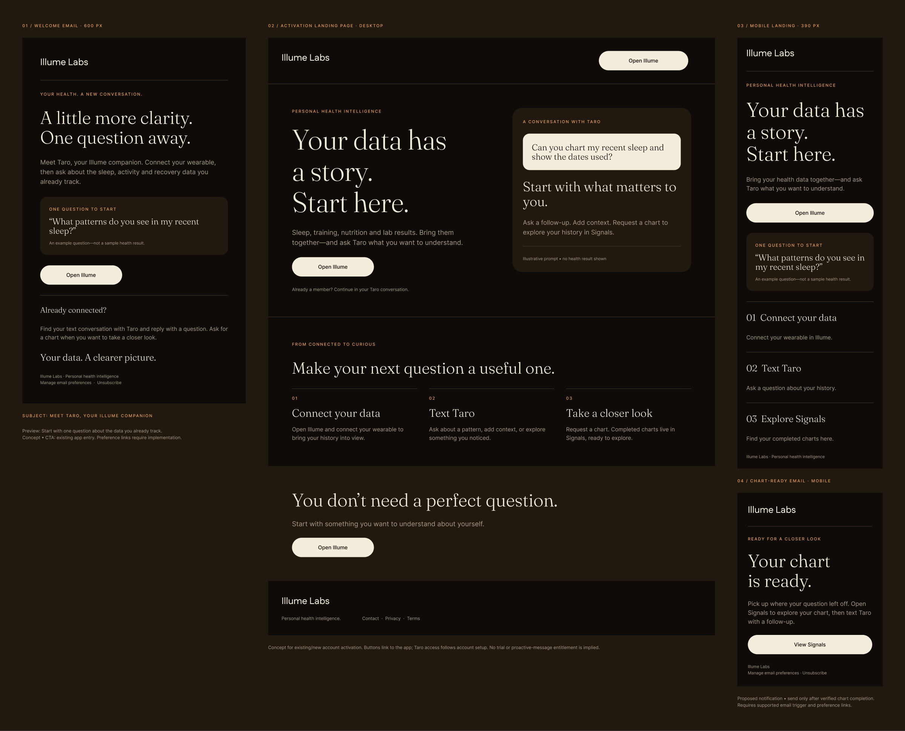

# Illume · From an automatic insight to a first conversation

I created an Illume account, connected my wearable history and received an automatic insight. I hadn’t asked a question yet. I then replied to Taro with a chart request and checked Signals for the result.

That experience gave this project a specific starting point: what helps someone act on an insight they already find interesting?

**Project status:** Independent walkthrough and activation proposal. My contribution includes using the product, sharing observations and testing the chart request. AI assisted with research synthesis, recommendations, copy and Figma production. No product changes or experiments have launched.

## Designs and supporting work

**[Open the editable Figma designs](https://www.figma.com/design/Rhk6OdhcG6vIbMKSTIRBio?node-id=4-136)**

The set contains a welcome email, desktop/mobile activation landing page and chart-ready email concept. Warm black, cream and amber carry through the layouts, with Fraunces headlines.

[Read the message drafts](illume/message-and-interface-copy.md) · [Inspect the evidence log and experiment](illume/experiment-and-evidence.md)

## The observation that changed the direction

An empty-looking dashboard initially raised a question about whether insights were reaching the user. The automatic text showed that they were reaching me.

That changed the focus of the proposal. Rather than treat this as missing insight, the brief addresses the handoff between the text conversation and the app: recognizing Taro, knowing what to ask and finding a requested chart.

## Three moments worth improving

**Recognizing the sender.** The visible text did not introduce Taro and my phone showed an unknown-sender notice. That is a reason to review sender recognition, not evidence of a delivery problem. Other onboarding surfaces might already contain an introduction.

**Knowing what to ask.** Signals explained that charts start in a Taro conversation. The reviewed state did not show an example prompt or visible start-conversation action. The proposed copy makes that step concrete:

> **Your charts start with a conversation**
>
> Ask Taro to visualize something in your connected data. Try: “Chart my recent sleep history and show the dates used.” Completed charts appear here.

**Understanding request status.** Taro acknowledged my chart request, but I did not see a completed chart after refreshing Signals during the walkthrough. The saved notes do not establish the final result or total wait time. The recommendation is to show received, preparing, ready and failed states when the backend can confirm them.

The chart-ready email is a concept for that last step. It does not mean my request completed.

## The first experiment in the proposal

Keep the existing insight and test a short sender introduction plus one relevant reply prompt.

The proposed primary measure is a meaningful reply within 48 hours of confirmed delivery. A relevant question or added context counts; “thanks” and opt-outs do not. A second useful interaction within seven days would help assess whether the first exchange led anywhere.

Chart-status changes would be tested separately. Opt-outs, negative feedback and support requests would be monitored alongside engagement.

This needs baseline data, confirmed messaging eligibility and sufficient user volume before it can run. The [experiment brief](illume/experiment-and-evidence.md) contains the definitions and four-week plan.

## What remains open

The saved walkthrough did not resolve chart completion, the full onboarding sequence or plan-specific behavior. It covered one account. Broader category feedback helped form questions, but it was not treated as Illume customer research.

The concrete output is a documented walkthrough, revised problem definition, copy pack, design set and test proposal.

Research snapshot: October 29, 2026. [Illume website](https://www.illumelabs.ai/) · [Product Hunt listing](https://www.producthunt.com/products/illume-labs)

[Back to portfolio](../README.md)
