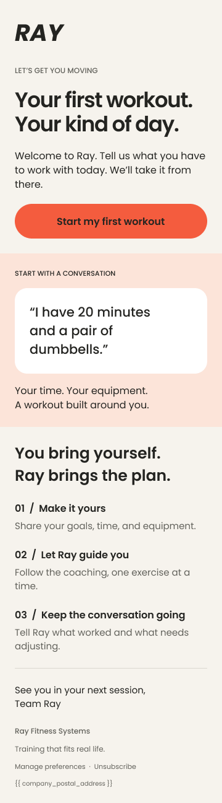
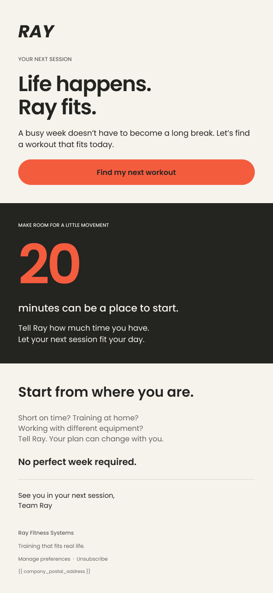

# Ray · A first workout and a way back

This project focuses on two moments: helping a new user complete a first workout and helping someone return after their routine slips.

**Project status:** Independent growth and lifecycle proposal based on public information, not commissioned by or affiliated with Ray. It includes Figma concepts and an AI-assisted strategy draft. No user interviews, internal analytics or live campaign results are claimed.

## The email concepts

[Open all desktop and mobile layouts in Figma](https://www.figma.com/design/e99rFNf5MD8VNKjVROExqw/?node-id=0-1)

### Welcome: make the first action concrete

**Subject:** Your first workout starts with you  
**CTA:** Start my first workout

The example “I have 20 minutes and a pair of dumbbells” gives someone a practical way to begin a conversation. It connects the promise of personalization to information the user can provide.

The proposed welcome test would include eligible signups who have not completed a workout. Compare the message with the existing journey and measure first-workout completion within 48 hours, then second-workout completion within seven days.

### Return: offer a next step without guilt

**Subject:** Life happens. Ray fits.  
**CTA:** Find my next workout

The message offers a manageable next session rather than asking someone to recover an entire missed routine. The 20-minute reference is an illustrative creative example.

The proposed pilot would include users with active access who completed a workout but have not returned for seven days. Compare against a randomized holdout and measure a completed workout within 72 hours. Returning, paused, cancelled or unsubscribed users would be suppressed as appropriate.

## The broader first-week journey

The starting audience hypothesis is busy adults returning to exercise. Interviews would need to establish whether time, planning, confidence or accountability is the main barrier.

| Moment | Proposed message | Intended action |
| :--- | :--- | :--- |
| No first workout | “Start with the time you have.” | Choose a feasible first session |
| First workout completed | “You made a start. When would your next workout fit?” | Plan a second session |
| A planned session is missed | “Plans change. Want to move your workout to a better time?” | Reschedule |
| End of the first week | “What worked for you this week? Build next week around that.” | Choose a realistic cadence |

Messages would respond to behavior rather than send simply because a calendar day arrived. Scheduling is useful, but the follow-through matters: the measurement plan distinguishes scheduling a session from completing it.

## Acquisition and referrals

The acquisition proposal compares creative about fitting exercise into a busy day with feature-led messaging. Cost per activated user and later return behavior would matter alongside signup cost.

Referral invitations would come after demonstrated repeat use. The project does not assume a specific invitation trigger is already supported or effective.

## The proposed 90-day scope

**First month:** audit the product journey, speak with users and establish event definitions and baselines.

**Second month:** test first-workout and second-session prompts, then compare acquisition cohorts on activation.

**Third month:** assess repeat use, refine the return journey and investigate referral timing if retention supports it.

Sample sizes and test duration would depend on actual volume and baseline behavior. Unsubscribes, complaints and abandonment would be tracked alongside the intended actions.

## Design handoff

The file contains 600px desktop and 360px mobile layouts. Poppins is a concept substitute and the editable wordmark is a typographic study. Production would require approved brand assets, working links, preference fields and email-client testing.

The completed work is the strategy draft and design concepts. The next substantive step would be testing the assumptions with the product and its users.

[Ray website](https://www.rayfit.com/) · [App Store listing](https://apps.apple.com/us/app/ray-ai-personal-trainer/id6474633735) · [Back to portfolio](../README.md)
