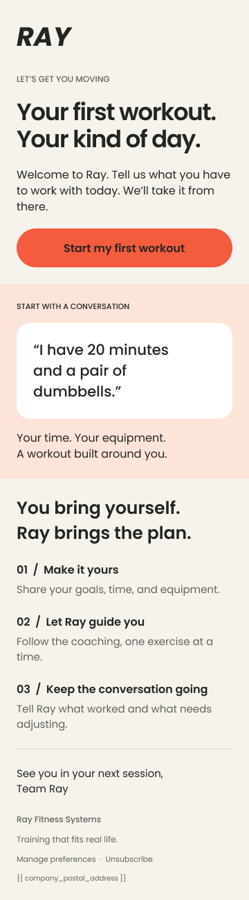
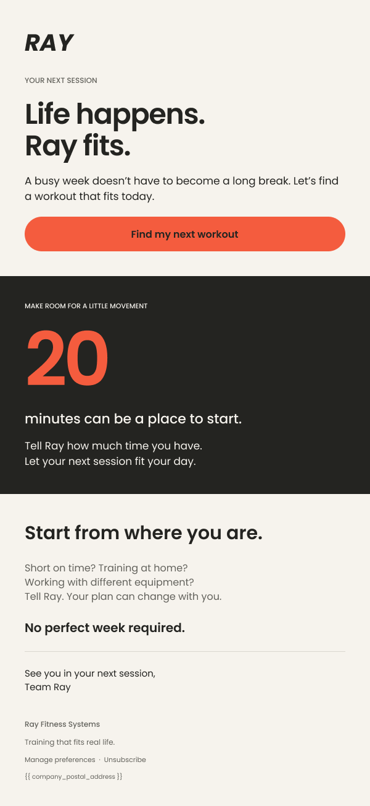

# Selected product & lifecycle copy

Two additional exercises explore product explanation, interface writing and lifecycle messaging. These new samples were generated with AI at Matthew's direction. They are transparent practice work, not shipped campaigns or evidence of independent writing authorship.

| Project | Writing you can review | Status |
| :--- | :--- | :--- |
| [Frameplay: see where your still could go](frameplay.md) | AI creative-tool landing page, onboarding, recovery states, activation email, feature launch, ads and a product-film script | Fictional product · AI-generated speculative exercise |
| [FocusFlow: a plan that leaves room for real life](focusflow.md) | Productivity landing page, interface copy, launch email, return email and ad variants | Fictional product · AI-generated speculative exercise |
| [Ray: two moments, one easier next step](#ray--two-moments-one-easier-next-step) | Welcome and return emails with Figma mockups | Independent concepts · Not deployed |

## Ray · Two moments. One easier next step.

A welcome email that makes the first workout feel approachable. A return email that gives someone a way back after a busy week.

**Independent concepts. Not commissioned by or affiliated with Ray. These emails have not been deployed and have no measured campaign results.** Figma mockups by Matthew Shelton.

[View the Figma layouts](https://www.figma.com/design/e99rFNf5MD8VNKjVROExqw/?node-id=0-1) · [Read the full strategy](../case-studies/ray.md) · [Contact Matthew](https://www.linkedin.com/in/mattshelton2000/)

### 01 · Help someone start

**Audience hypothesis:** a new user who wants to exercise but needs help choosing a feasible first session.

**Writing problem:** turn a broad promise of personalized training into a concrete action.

> **Your first workout.  
> Your kind of day.**
>
> Welcome to Ray. Tell us what you have to work with today. We’ll take it from there.
>
> **Start my first workout**

**Subject:** Your first workout starts with you  
**Preheader:** Tell Ray what fits today. Let’s get moving.

**Why the execution works as a concept:** the headline puts the user's circumstances first. The example prompt, “I have 20 minutes and a pair of dumbbells,” makes a conversational interface easier to understand. The CTA names the desired action.

**What would need testing:** whether this clarity helps eligible new users complete a first workout within 48 hours. The proposed secondary measure is a second workout within seven days. Neither outcome has been measured.

### 02 · Make returning feel possible

**Audience hypothesis:** someone with a previously completed session who has stopped returning.

**Writing problem:** invite another workout without making the user feel behind.

> **Life happens.  
> Ray fits.**
>
> A busy week doesn’t have to become a long break. Let’s find a workout that fits today.
>
> **Find my next workout**
>
> No perfect week required.

**Subject:** Life happens. Ray fits.  
**Preheader:** A shorter session can be your next step.

**Why the execution works as a concept:** the headline acknowledges an interruption without assigning blame. The action is a next workout rather than an abstract commitment to fitness. The 20-minute reference is an illustrative starting point, not a universal training recommendation.

**What would need testing:** a pilot after seven days without a workout among eligible users with active access. Compare completed return workouts within 72 hours of assignment against a holdout, with unsubscribes and complaints as guardrails.

### One voice across both moments

| Choice | Welcome | Return |
| :--- | :--- | :--- |
| User context | A first session needs a starting point | A disrupted routine needs a way back |
| Tone | Encouraging and practical | Understanding and flexible |
| Action | Start my first workout | Find my next workout |
| Supporting idea | Your time and equipment | No perfect week required |

The file includes desktop and mobile layouts for both concepts. The editable wordmark is a typographic study, not the official logo. Product behavior, links, consent rules, footer fields and email-client rendering require verification before any production use.

## Commercial background

The [consumer-growth summaries](../case-studies/consumer-growth.md) describe broader contributions at Heelys, DVS and Andrews University. Their reported outcomes are not attributed to the Ray concepts or presented as proof that an individual line of copy caused a result.

## Workflow project

[AI Lifecycle Studio](../ai-lifecycle-studio/README.md) demonstrates campaign structure, rule-based review and local exports using authored samples. It is a static workflow demo, not a live model benchmark.

[Back to the full portfolio](../README.md)
